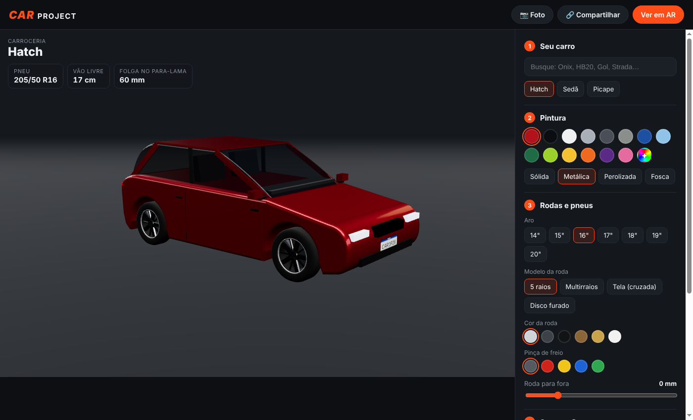

# 🚗 Car Project

**Monte o projeto do seu carro antes de gastar com peças.** Escolha seu carro, troque roda, aro, pintura e suspensão, veja tudo em 3D e coloque o carro no chão em tamanho real com **realidade aumentada**.

> Hoje quem quer planejar um projeto só tem edição de foto ou jogo com mod. O Car Project quer ser a ferramenta de verdade: medidas reais, peças reais e aviso quando algo não vai servir.



## O que já funciona (protótipo v0.1)

| Área | Recursos |
|---|---|
| **Seu carro** | Busca por modelos populares no Brasil (Onix, HB20, Gol, Strada…) e carrocerias Hatch, Sedã e Picape |
| **Pintura** | 14 cores prontas + cor personalizada, acabamentos sólido, metálico, perolizado e fosco |
| **Rodas e pneus** | Aro 14" a 20", 4 modelos de roda, 6 cores de roda, cor da pinça de freio, roda para fora |
| **Suspensão** | Rebaixar ou elevar (-90 mm a +60 mm) e cambagem |
| **Extras** | Insulfilm, aerofólio (hatch/sedã) e Santo Antônio (picape) |
| **Encaixe (fitment)** | Medida do pneu, vão livre e folga no para-lama calculados na hora, com avisos quando o pneu encosta, raspa ou fica para fora |
| **Realidade aumentada** | Botão **Ver em AR**: o carro montado é exportado em GLB e aberto no celular (Android/Chrome e iPhone/Safari) em escala real |
| **Compartilhar** | O projeto fica salvo no link: dá para mandar no WhatsApp. Também baixa foto em PNG |

## Como rodar

Precisa do [Node.js](https://nodejs.org) 20 ou mais novo.

```bash
npm install
npm run dev      # abre em http://localhost:5173
npm run build    # gera a versão final em dist/
```

Para testar o AR no celular, o site precisa estar em **HTTPS**, então use o GitHub Pages (abaixo) ou `npm run dev -- --host` com um túnel HTTPS.

## Publicar de graça no GitHub Pages

O repositório já tem o workflow em `.github/workflows/deploy.yml`. Só precisa ligar uma vez:

1. No GitHub, abra **Settings → Pages**
2. Em **Source**, escolha **GitHub Actions**
3. Pronto: cada push na `main` publica em `https://luishenriquel.github.io/car-project/`

## Tecnologias

- [React](https://react.dev) + [Vite](https://vite.dev)
- [Three.js](https://threejs.org) com [React Three Fiber](https://r3f.docs.pmnd.rs) e [drei](https://drei.docs.pmnd.rs) para o 3D
- [`<model-viewer>`](https://modelviewer.dev) do Google para a realidade aumentada (WebXR, Scene Viewer e Quick Look)

## Estrutura

```
src/
  App.jsx            interface e cena 3D
  car/
    bodies.js        perfis das carrocerias (hatch, sedã, picape)
    Car.jsx          monta o carro (lataria, vidros, luzes, caçamba, extras)
    Wheel.jsx        roda, pneu, disco e pinça de freio
    specs.js         medidas do pneu e cálculos de encaixe
  data/options.js    catálogo de carros, cores, rodas e valores padrão
  ui/
    ARViewer.jsx     exporta o carro em GLB e abre em AR
    share.js         salva o projeto no link
```

## Próximos passos

- [ ] **Modelos 3D reais** dos carros mais vendidos no Brasil (começar por 10 modelos)
- [ ] **Escanear o próprio carro** com o celular (fotogrametria / LiDAR) para gerar o 3D exato
- [ ] **Catálogo de peças reais** com medidas (aro, tala, ET, furação), preço e link de compra
- [ ] Fitment por modelo: rodas e amortecedores que servem no seu carro
- [ ] Mais peças: para-choques, saias, faróis, escapamento, envelopamento e adesivos
- [ ] Conta de usuário, "Minha garagem" e comunidade para votar nos projetos
- [ ] Orçamento com oficinas da sua cidade
- [ ] App nativo (iOS/Android) com AR mais preciso
